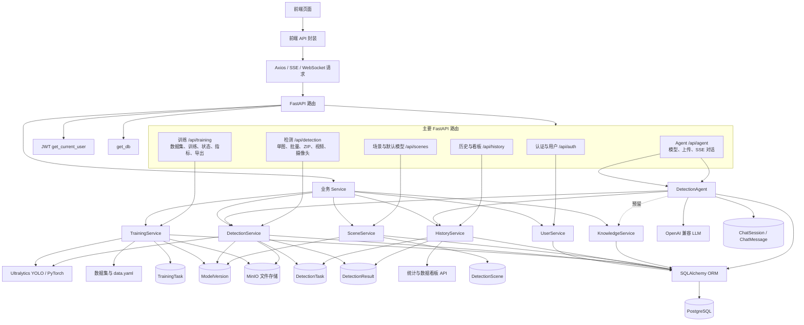

# 项目协作规范
代码基线：`origin/dev`，提交 `c42415c`（2026-07-17，同步最新 dev）
开始任务前尽可能阅读本文，使用AI编程时把此文件喂给AI

## 目录

- [1. 当前进度](#1-当前进度)
- [2. 分工](#2-分工)
- [3.命名与接口规范](#3-命名与接口规范)
- [4. Git 使用与提交规范](#4-git-使用与提交规范)
- [5. 每次项目开始与结束的运行、验证流程](#5-每次项目开始与结束的运行验证流程)
- [6. 文件结构与环境依赖](#6-文件结构与环境依赖)

---

## 1. 当前进度

本节以 `origin/dev` 提交 `c42415c` 的代码结构为基线。**“代码已具备”只表示路由、Service、页面或测试入口存在，不等于真实环境、跨页面和端到端验收已经完成。**

### 1.1 基础环境、配置、认证与数据库

| 模块 | 最新 dev 已有能力 | 当前进度 | 后续缺口完善和交付 | 验收与测试 |
|---|---|---|---|---|
| 环境、配置、认证与权限 | FastAPI 配置、JWT、密码哈希、注册/登录/资料/改密/重置；角色、管理员启停用和删除用户接口；Compose 提供 PostgreSQL、Redis、MinIO、可选 Ollama | 基础链路已具备，生产化未完成 | 统一 `.env.example` 和环境变量说明；移除默认密码/密钥；明确生产 CORS、上传安全、日志脱敏、角色边界；补管理员前端页面、设置配置保存/刷新恢复和全局错误码定位 | 空环境启动；注册、登录、改密、重置、权限隔离、管理员操作、异常日志和错误码回归 |
| 数据库、迁移、持久化与生命周期 | SQLAlchemy ORM、Pydantic Schema、Alembic 初始及增量迁移、seed；用户、检测任务/结果、训练任务/指标、模型、会话/消息、知识文档/分块等表和级联关系已存在 | 数据结构基本具备，真实初始化和跨模块落库边界仍需验收 | 完成空库升级/回滚/seed、云端初始化、数据隔离、审计日志边界；协调 Agent 会话/消息/附件/工具结果/记忆落库；统一删除级联、MinIO 清理和失败补偿 | 迁移可重复；用户/任务/会话/RAG 数据隔离；删除后关联数据和对象存储无残留；刷新/切页后数据可恢复 |

### 1.2 数据集、训练、模型与检测服务

| 模块 | 最新 dev 已有能力 | 当前进度 | 后续缺口完善和交付 | 验收与测试 |
|---|---|---|---|---|
| 数据集、训练、评估与模型版本 | `TrainingService`、训练 API、数据集上传/列表/删除、训练任务状态/指标/停止、验证、导出、下载、预测、模型登记；训练页面和训练相关测试已存在 | 训练代码闭环基本具备，真实数据和可复现实验未完成 | 模型/数据/训练负责人冻结数据集、类别、`data.yaml`、参数和输出目录；完成真实训练、监控、停止、评估、调优、导出、下载、预测和版本登记；交付指标/评估图、权重和模型报告 | 数据校验、类别分布、空环境训练、状态机、停止/失败、评估导出、下载、预测、模型登记和复现实验 |
| 单图、批量、ZIP 与文件服务 | `DetectionService`、单图/批量/ZIP API、YOLO 推理、MinIO 原图/标注图、历史落库；文件浏览页面支持数据集/模型查看、上传、下载、删除和默认模型操作 | 主要功能已具备，真实模型/MinIO/权限和清理边界未完全验收 | 补失败重试、并发控制、路径校验、上传大小/类型、用户资产权限、内置资源保护、数据库删除与 MinIO 清理；统一全局“可查看/可编辑/可上传/可下载/可删除”规则 | 真实模型/MinIO/数据库端到端；空文件、非法路径、越权、删除失败、存储失败、并发和性能回归 |
| 视频、摄像头与跨页面后台任务 | 视频 API、Redis 进度、视频状态查询、视频结果/标注视频、摄像头 WebSocket 和视频帧追踪代码已存在 | 视频代码链路已具备；摄像头结果归档、断线/资源释放和任务生命周期仍需真实验收 | 训练、视频和检测任务统一由后端持续托管；前端用全局任务状态/任务中心在切页、返回或刷新后重新查询，不重复启动、不丢失结果；补 GPU/CPU 策略、断线重连、失败任务和资源释放 | 真实视频帧率、摄像头稳定性、断线恢复、任务继续运行、状态/进度/失败原因/结果可查询；验证不重复启动 |

### 1.3 前端页面、全局体验与数据看板

| 模块 | 最新 dev 已有能力 | 当前进度 | 后续缺口完善和交付 | 验收与测试 |
|---|---|---|---|---|
| 工作台、训练页面、历史与看板 | 检测、训练、文件、历史、看板页面；统计 API、历史详情/删除/筛选、图表和空态组件；设置组件和全局布局已存在 | 页面和 API 适配基本具备，真实数据体验和统一化不足 | 前端 B 完成训练页面前端优化、任务中心、历史/看板真实数据、日期口径、详情钻取、用户设置、加载/空/错误态；全局统一头部、筛选栏、上传区、表格、卡片、按钮、弹窗、响应式和中英文文本；隔离无效 mock、删除冗余代码 | 训练配置/上传/监控/评估/导出；历史筛选/详情/删除；看板统计口径、空态、权限、接口失败、响应式、构建和交叉页面回归 |
| 管理员页面与全局资源操作 | 后端已有管理员启停用/删除用户、模型软删除/默认模型、数据集/训练任务/历史/会话删除接口；普通用户权限检查已有 | 管理员前端和全局资源编辑能力不完整 | 增加用户/角色/权限运营页面；统一资源操作确认、上传、下载、编辑、删除和权限提示；内置资源不可误删，删除必须同步数据库和 MinIO | 管理员与普通用户操作矩阵；越权、危险操作确认、删除级联、错误码和刷新恢复 |
| 全局接口调用与错误定位 | `src/api/`、`utils/request.js`、`stream.js`、`cameraWs.js`、`apiError.js` 和错误上报已有；API/SSE/WebSocket 调用已分层 | 调用入口已统一，错误契约和链路追踪不完整 | 后端统一错误码/错误结构/request-task 标识；前端按错误码准确展示；统一认证、响应适配、重试、取消、SSE/WebSocket、任务查询和错误上报链路；接口变化同步 Schema、测试和文档 | 错误码覆盖认证、权限、参数、文件、模型、训练、检测、存储、SSE/WebSocket；日志可关联用户、请求和任务 |

### 1.4 Agent、会话历史与 RAG

| 模块 | 最新 dev 已有能力 | 当前进度 | 后续缺口完善和交付 | 验收与测试 |
|---|---|---|---|---|
| Agent、多 Agent、SSE 与会话 | Supervisor、多 Agent 路由、Detection/Data/General Agent、检测/历史/统计工具、会话列表/详情/删除、图片上传、SSE API、聊天页面和消息组件已存在 | 多 Agent 主流程和聊天页面已具备，真实模型调用与稳定性仍需联调 | 组长负责 Agent 图、Prompt、真实 LLM、路由边界、工具结果和会话落库协调；前端 A 优化模型选择、附件、消息流、思考态、工具卡、取消/重试、重连和会话历史恢复；切页/刷新后消息和任务可恢复 | 真实模型调用、SSE 分片/`[DONE]`、工具调用、附件保存、会话刷新恢复、删除、取消、重连、异常和权限回归 |
| RAG 与知识库 | 知识文档/分块 ORM、Schema、`KnowledgeService` 和 Agent `search_knowledge` 工具入口存在 | RAG 检索仍是预留/占位，未作为完成能力验收 | 完成文档上传/解析/切片/embedding/pgvector 检索、权限过滤、引用结果、文档删除和 MinIO 清理；接入 Agent 工具并保存检索结果 | 文档入库、相似度检索、权限隔离、无结果、删除、embedding/数据库异常和 Agent 真实联调 |

### 1.5 部署、质量、可观测性与交付

| 模块 | 最新 dev 已有能力 | 当前进度 | 后续缺口完善和交付 | 验收与测试 |
|---|---|---|---|---|
| 部署、配置安全与恢复 | 基础 Compose、健康检查、日志/异常基础能力和 README/前端 README 已存在 | 基础设施可启动，应用容器化和生产运维未完成 | 补后端/前端 Dockerfile、完整 Compose、生产配置、密钥策略、日志收集、备份恢复、发布回滚和部署手册；完成安全复核 | 空环境 Docker 完整部署、升级/回滚、备份恢复、密钥/CORS/上传安全和日志脱敏演练 |
| 测试、CI、覆盖率与可观测性 | 后端 API/Service 测试、前端 Vitest/API/组件测试、健康检查和错误上报已有 | 单元测试基础存在，真实环境 E2E、性能、CI 和缺陷台账不足 | 文档/测试/部署负责人组织后端/API、前端组件、E2E、真实训练/检测/Agent、迁移、权限、SSE/WebSocket、性能回归；建立 CI、覆盖率基线、错误码表、缺陷台账和日志收集 | 测试结果可复现；失败项有记录和负责人；CI 报告、覆盖率、性能基线和运行日志可追溯 |
| 文档、模型报告与答辩交付 | 项目规范、README、教学/设计资料和基础运行说明已存在 | 交付材料不完整 | 补部署说明、API/测试报告、模型指标报告、验收日志、录屏、PPT、交付清单和回滚/恢复记录 | 按交付清单逐项核验；演示环境可复现；报告、截图、日志和代码基线一致 |

---

## 2. 分工、交付接口、文件边界与测试责任

### 2.1 全员通用规则

1. 每个文件有主负责人。跨边界修改在 PR 中说明原因、影响和测试。
2. 前端不直接修改后端业务、SQLAlchemy 模型或迁移；后端不直接修改业务页面的样式和交互。通过 Schema、OpenAPI、`src/api/` 层协作。
3. 任何数据库字段、API 字段、枚举、类别 ID、环境变量变化，都必须同步更新实现、Schema、测试和文档。
4. `main.py`、`settings.py`、`db_models.py`、`schemas.py`、`router/index.js`、`docker-compose.yml` 为共享文件：只有主负责人合并，其他成员提交最小补丁并请求审阅。

### 2.2 组长 / 架构、集成与 Agent 负责人

| 项目 | 约定 |
|---|---|
| 全程任务 | 维护架构和接口总表；协调依赖顺序；负责 Agent 图、跨模块集成、冲突裁决、发布验收、答辩总述 |
| 后续缺口完善和交付 | 统筹 Agent 配置、Prompt、真实 LLM、SSE、上下文、记忆、会话/消息/附件/工具结果落库、跨页面恢复和错误码链路；把知识库占位检索升级为真实 RAG，协调多 Agent 路由、检测/历史/统计工具和全局接口调用链；负责删除冗余代码的跨模块审查，并组织发布验收。验收以真实模型调用、稳定流式事件、刷新/切页可恢复、不重复保存、RAG 有检索结果且权限正确为准。 |
| 负责文件和接口范围 | 后端 `backend/app/agent/**`、`backend/app/api/agent.py`、`backend/app/config/llm.py`，前端 Agent 入口 `frontend/src/api/agent.js`、`frontend/src/stores/agent.js`、`frontend/src/views/ChatPage.vue`；协调 `/api/agent/models`、`sessions`、`upload`、`chat/stream` SSE 及检测/历史/知识库接口。ORM、迁移、训练核心和业务页面由对应负责人修改，本人负责跨模块方案与评审。 |
| 测试责任 | Agent 路由、SSE 事件、携图检测工具、历史统计工具、真实 SSE 人工联调 |

### 2.3 后端 A：认证、数据库、场景、历史与公共 API 负责人

| 项目 | 约定 |
|---|---|
| 全程任务 | 维护数据库契约、认证权限、场景和模型元数据、历史和统计；为检测/训练/Agent 提供持久化和查询服务 |
| 后续缺口完善和交付 | 完成空库迁移/回滚/seed、云端初始化、用户/系统权限隔离、管理员用户接口、任务/会话/RAG 数据表、删除级联和审计边界；统一 API Schema、错误码和 request/task 标识，使前端能准确定位认证、权限、数据、文件和任务错误；核对训练、检测、历史、看板、模型和 Agent 数据的保存、查询、删除及刷新恢复。验收以迁移可重复、普通用户不能越权、删除能清理关联数据、错误日志可关联为准。 |
| 负责文件和接口范围 | `backend/app/api/auth.py`、`history.py`、`scenes.py`、健康/公共路由；`backend/app/services/user_service.py`、`history_service.py`、`scene_service.py`、`knowledge_service.py`；`backend/app/entity/**`、`database/**`、`alembic/**`、`core/exceptions.py` 和对应测试；负责 `/api/auth/*`、`/api/scenes/*`、`/api/history*`、统计、管理员和数据契约，训练/检测/Agent 业务通过 Schema/Service 协作。 |
| 测试责任 | 认证成功/失败/权限、迁移升级、场景唯一性、历史分页/隔离/删除、统计、外键和级联关系 |

### 2.4 后端 B：检测、推理与对象存储负责人

| 项目 | 约定 |
|---|---|
| 全程任务 | 维护 YOLO 推理、检测文件、MinIO 和视频/摄像头运行链路；与模型/数据负责人协作提供训练基础设施和接口集成 |
| 后续缺口完善和交付 | 完成单图、批量、ZIP、视频、摄像头的真实模型/MinIO/数据库闭环；补齐失败任务、并发、GPU/CPU 策略、断线重连、资源释放、结果归档和性能验收；负责数据集/模型/原图/标注图的文件服务、下载和物理清理；为训练负责人提供任务执行、状态、停止、评估/导出/预测运行支撑。验收以切页/刷新后任务继续、失败可定位、结果可被历史/看板/Agent 使用为准。 |
| 负责文件和接口范围 | `backend/app/config/detection.py`、`storage/minio_client.py`、`services/detection_service.py`、`api/detection.py`、`tools/**`；与训练负责人共同维护训练运行时。负责 `/api/detection/single`、`batch`、`zip`、`video`、视频状态和摄像头 WebSocket，以及 MinIO 文件读写/清理；结果通过 `HistoryService` 落库，不直接修改 Auth、迁移、统计 SQL、Vue 页面或 Agent 图。 |
| 测试责任 | 路径校验、训练状态机、指标解析、停止、模型加载失败、单图/批量推理、空结果、MinIO 失败、历史保存、基础性能检查 |

### 2.5 前端 A：Agent 对话和流式交互负责人

| 项目 | 约定 |
|---|---|
| 全程任务 | 负责聊天体验与 SSE 消费；不承担后端推理、数据库和 Agent 决策逻辑 |
| 后续缺口完善和交付 | 完成 Agent 前端统一优化：模型选择、Prompt、附件上传、消息流、思考态、工具状态、检测结果卡片、取消/重试、断线重连和错误码展示；优化会话历史的列表、加载、删除、消息/附件恢复和服务端同步；配合全局元素统一化。验收以真实 SSE 分片可消费、切页/刷新可恢复、会话不丢消息/附件、错误码提示准确为准。 |
| 负责文件和接口范围 | `frontend/src/views/ChatPage.vue`、`components/agent/**`、`api/agent.js`、`stores/agent.js`、`utils/stream.js`、`utils/markdown.js`、全局 `utils/request.js` 的前端适配；负责 `text_delta`、`tool_start`、`tool_result`、`error`、`message_end`、`[DONE]` 等 SSE 事件消费，不直接修改后端 Agent 图、ORM、训练/检测/看板页面或字段定义。 |
| 测试责任 | 分片解析、`[DONE]`、取消、工具卡、携图发送、错误提示、无 mock 的真实接口联调 |

### 2.6 前端 B：检测工作台、训练管理、历史和看板负责人

| 项目 | 约定 |
|---|---|
| 全程任务 | 负责业务页面、表单、图表、上传和 API 调用层；组件内不写后端业务规则 |
| 后续缺口完善和交付 | 完成训练页面前端优化、检测工作台、历史/看板真实数据、文件管理和管理员页面；建立全局任务中心/Pinia 状态，使训练、视频和检测切页/刷新后能恢复查询；统一页面头部、筛选栏、上传区、表格、卡片、按钮、弹窗、空态/加载态/错误态、设置和中英文文本；实现资源可查看、编辑、上传、下载、删除并显示准确错误。验收以真实接口、无 mock 冒充、权限正确、任务不重复启动和界面一致为准。 |
| 负责文件和接口范围 | 页面 `DetectionPage.vue`、`TrainingPage.vue`、`FileBrowserPage.vue`、`HistoryPage.vue`、`DashboardPage.vue`；公共 `components/layout/**`、`components/common/**`、`components/charts/**`、`components/detection/**`、`components/settings/**`；API `detection.js`、`training.js`、`models.js`、`history.js`、`statistics.js`、`auth.js`，请求统一经 `utils/request.js`；不修改后端路由、ORM、训练线程、Agent 组件或 Token 规则。 |
| 测试责任 | 上传格式/大小、检测成功/空结果/失败、训练列表与图表、历史分页/删除、看板空态、路由权限、构建 |

### 2.7 模型 / 数据 / 训练负责人

| 项目 | 约定 |
|---|---|
| 全程任务 | 负责数据来源、类别、转换、验证、训练服务、训练试验、评估、调优与模型交付；不直接修改 Web 业务代码 |
| 后续缺口完善和交付 | 主责训练服务和训练 API 契约：冻结可复现数据集、类别、`data.yaml`、训练参数和输出目录；完成真实训练、监控、停止、评估、调优、导出、下载、预测、模型登记和跨页面任务状态；交付指标/评估图、权重和模型报告。验收以真实训练可复现、结果可查询、切页/刷新任务继续、模型可被检测和 Agent 使用为准。 |
| 负责文件和接口范围 | `backend/app/training/**`、`backend/app/api/training.py`、`datasets/ssdd/**`、`models/**`、`docs/model_report.md`、数据工具和训练配置；负责 `/api/training/datasets`、上传、启动、任务状态/指标、停止、结果、验证、导出、下载和预测，以及 `data.yaml`、权重、指标 JSON/CSV、评估图片；训练运行时、MinIO 和检测接口与后端 B 共同评审，不修改 Auth、ORM、Vue 页面或 Agent 工作流。 |
| 测试责任 | 数据校验通过、可视化抽检、类别分布、空环境训练、训练状态机、停止/失败、评估导出、下载、预测、模型登记和推理样例核验 |

### 2.8 文档 / 测试 / 部署负责人

| 项目 | 约定 |
|---|---|
| 全程任务 | 维护 README、报告、验收记录、测试策略、部署、录屏与答辩材料；不代替业务负责人实现业务逻辑 |
| 后续缺口完善和交付 | 负责 API/部署/测试文档、完整 Compose、CI、覆盖率基线、缺陷台账、错误码定位回归、真实训练/检测/Agent E2E、性能/SSE/WebSocket/迁移/权限测试；组织删除冗余代码和 mock 隔离的复核；交付部署手册、模型/测试报告、验收日志、录屏、PPT、备份恢复和发布回滚演练。验收以测试结果可复现、失败项有记录、交付材料齐全为准。 |
| 负责文件和接口范围 | `docs/**`、`README.md`、`backend/tests/**`、`frontend/tests/**`、CI 配置、`docker-compose.yml`/`Dockerfile*`（与后端 A/B 联审）；维护测试数据、错误码表、部署命令、环境变量表、验收日志和交付材料，不直接修改业务算法、ORM 字段、页面交互或 Agent Prompt。 |
| 测试责任 | 执行和记录环境、认证、训练、检测、历史、Agent、构建、Docker 回归；维护测试数据和预期结果 |

---

## 3. 命名与接口规范

### 3.1 SSDD 自定义命名

| 对象 | 统一命名 |
|---|---|
| 项目缩写 | `ssdd`（Steel Surface Defect Detection） |
| 数据集根目录 | `datasets/ssdd/` |
| MinIO 桶 | `ssdd-images`（小写） |
| 训练输出根目录 | `runs/train/`，配置解析为项目根目录下的绝对路径 |
| 场景标识 | `steel_surface_defect` |
| 模型内部名 | `yolo11n`、`yolo11s`、`yolo11m`、`yolo11l`、`yolo11x`；UI/文档可写 YOLOv11 |
| 模型文件 | `yolo11n.pt`、`ssdd_yolo11n_v1.pt`，禁止 `final.pt`、`new.pt` |
| 训练任务目录 | `task_<task_uuid>` |
| 检测领域名 | `detection_task`、`detection_result`，文档不再混用 `detection_record` |
| 缺陷类别 | 英文 `snake_case`，例如 `pitted_surface`；中文仅用于展示 |

### 3.2 代码和数据库规范

- Python 模块、函数、变量：`snake_case`；类：`PascalCase`；常量：`UPPER_SNAKE_CASE`。
- Vue 组件：`PascalCase.vue`；页面：`XxxPage.vue`；Pinia/API 文件：资源名小写。
- 表名：复数 `snake_case`；外键：`<entity>_id`；时间：`created_at`、`updated_at`、`started_at`、`completed_at`。
- Schema：`XxxCreate`、`XxxUpdate`、`XxxResponse`、`XxxDetail`、`XxxPageResponse`；禁止直接返回 ORM 对象。
- 数据库写入边界：检测结果仅由 `DetectionService` 通过 `HistoryService` 写入；训练任务/指标仅由 `TrainingService` 写入；聊天会话/消息仅由 Agent API 写入。RAG 文档、向量检索和多智能体会话/任务表落地后，统一由相应 Service 写入。
- 修改 ORM 或表结构：先设计 Schema，再由后端 A 建 Alembic 迁移，最后在空库和测试库升级；禁止手改数据库代替迁移。涉及用户、任务、模型、会话删除时，必须同时说明级联、MinIO 清理和权限影响。

### 3.3 HTTP API 规范

所有接口以 `/api` 开头；路由负责鉴权、校验和 HTTP 响应，业务逻辑在 Service。认证统一用 `Authorization: Bearer <token>`。

| 模块 | 接口 | 主负责人 |
|---|---|---|
| Health | `GET /api/health`、`GET /api/health/detail` | 后端 A |
| Auth | `/api/auth/register`、`login`、`me`、改密/重置/管理员用户接口 | 后端 A |
| Scenes | `GET/POST /api/scenes`、`GET /api/scenes/{id}`、默认模型切换 | 后端 A |
| Training | `/api/training/datasets`、`datasets/upload`、`start`、`tasks`、`status/{id}`、`metrics/{id}`、`stop/{id}`、`results/{uuid}`、`validate/{id}`、`export/{id}`、`download/{id}`、`predict` | 模型/数据/训练负责人（后端 B 协作） |
| Detection | `/api/detection/models/status`、`single`、`batch`、`zip`、`video`、`video/status/{task_id}`、`WS /api/detection/camera` | 后端 B |
| History | `/api/history`、`/{task_id}`、`/statistics/summary` | 后端 A |
| Agent | `/api/agent/models`、`models/cached`、`sessions`、`sessions/{id}`、会话图片、删除会话、`upload`、`chat/stream` SSE；RAG/知识库真实检索接口待补 | 组长/Agent 负责人 |

列表统一返回：

```json
{"total": 100, "page": 1, "page_size": 20, "total_pages": 5, "items": []}
```

错误统一返回：

```json
{"detail": "可读错误信息"}
```

单图检测接口最低响应包含任务 ID、场景/模型、原图/标注图 URL、类别、中文类别、置信度、bbox、汇总和推理耗时。现有 Pydantic Schema 与前端 `normalizeDetectionResponse()` 已覆盖 `task/id`、`objects/results/defect_results` 和 `snake_case/camelCase` 过渡字段；后续新增字段必须同步 Schema、前端适配、测试和本文档。

### 3.4 SSE 与代码分层

Agent SSE 固定输出 `data: <JSON>\n\n`，当前事件包括 `agent_switch`、`text_delta`、`tool_start`、`tool_result`、`error`、`message_end`，结束标记为 `data: [DONE]`。后端 Supervisor 的 `text_chunk`、`tool_call` 由 API 层映射为前端事件；前端由 `utils/stream.js` 统一解析；`VITE_USE_MOCK=false`、`VITE_USE_MOCK_AGENT=false` 为真实接口模式。

```text
Route/API       鉴权、Schema 校验、HTTP 状态，不写模型推理和 SQL 细节
Service         业务流程、事务、权限、异常转换
Training/Agent  训练、推理编排、Agent 状态图和工具
Storage         MinIO/Redis 等外部依赖适配
Entity          ORM 与 Pydantic Schema
Frontend API    唯一的 HTTP/SSE 调用入口
Vue Component   展示和交互，不直接使用 axios 或访问数据库
```

---

## 4. Git 使用流程与提交规范

### 4.1 获取最新代码并创建任务分支（尽可能每次开发前pull下来最新的dev文件夹）

```powershell
git status --short --branch
git fetch origin
git switch dev
git pull --ff-only origin dev
git switch -c feat/<scope>-<description>
```

不要在 `dev` 直接开发。若 `git status` 显示非本人改动，不执行 `reset --hard`、`checkout -- .` 或删除文件；先联系修改者。

分支格式：`feat/<scope>-<description>`、`fix/<scope>-<description>`、`refactor/<scope>-<description>`、`test/<scope>-<description>`、`docs/<description>`、`build/<description>`。

### 4.2 开发中的同步和接口使用

1. 编码前阅读相关 Schema、Service、测试和最近 PR，使用已有正确接口，不复制接口或直接读写其他模块数据库。
2. 任务超过一天或 `dev` 有关键改动时，先提交自己的最小工作单元，再 `git fetch origin` 和 `git rebase origin/dev`；已有 PR 的分支必须先确认目标分支仍为 `dev`。若团队统一使用 merge，则全员统一，不混用。
3. 冲突先理解两侧业务含义；共享文件冲突必须请主负责人参与，不用“全部接受当前/传入”草率解决。
4. 不暂存 `.env`、虚拟环境、`node_modules`、`dist`、缓存、日志、大型数据集或训练输出；已批准发布的模型权重须明确版本、来源、体积和使用方式。

### 4.3 提交前本地审查、最小提交与 PR（提交前一定要经过本地审查，提交时只提交最小改动版本）

```powershell
git diff --check
git diff --stat
git diff
git status --short
```

每个 commit 只做一个可描述、可回退、可评审的逻辑单元。提交格式：

```text
<type>(<scope>): <动作描述>
```

例如：

```text
feat(detection): 实现单图推理与结果存储
fix(training): 统一数据集和训练输出绝对路径
test(history): 覆盖按用户隔离的记录查询
docs(readme): 更新进度和协作规范
```

提交前运行与改动相符的测试；测试未运行时必须在 PR 说明原因和影响，不能写“测试通过”。PR 以 `dev` 为目标分支，必须写明：改动范围、接口/迁移变化、验证结果、风险/回滚、页面截图或接口示例。评审通过前不自行合并。

---

## 5. 每次项目开始与结束的运行、验证流程

### 5.1 首次或依赖变更后的准备

```powershell
python -m venv .venv
.\.venv\Scripts\python.exe -m pip install --upgrade pip
.\.venv\Scripts\python.exe -m pip install -r backend\requirements.txt

cd frontend
npm.cmd ci
cd ..
```

复制 `backend/.env.example` 为 `backend/.env`，只填本机开发配置；`DB_*`、`REDIS_*`、`MINIO_*` 必须与 Compose 一致。调试真实 Agent 时还需配置可用的模型 API Key/Base URL；真实密钥绝不提交。

### 5.2 每次开始运行

启动基础设施：

```powershell
docker compose up -d postgres redis minio
docker compose ps
docker compose exec redis redis-cli ping
curl.exe -I http://localhost:9001
```

必须确认 `postgres`、`redis`、`minio` 均为 `healthy`；`redis-cli ping` 应返回 `PONG`，MinIO 控制台 `9001` 应返回 `200`。不要只看容器已启动，后端启动后还要执行应用依赖检查。

如需本地 LLM：`docker compose --profile optional up -d ollama`。

启动后端：

```powershell
cd backend
..\.venv\Scripts\python.exe -m alembic current
..\.venv\Scripts\python.exe -m alembic upgrade head

# 真实 Agent 使用 DashScope 时，在后端子进程启动前临时绕过系统代理
$env:NO_PROXY = "dashscope.aliyuncs.com"
$env:no_proxy = "dashscope.aliyuncs.com"
..\.venv\Scripts\python.exe -m uvicorn main:app --host 0.0.0.0 --port 8000 --reload
```

当前代码默认端口为 `8000`，但 `main.py` 使用 `reload=True`。开发调试和安全重启统一使用上面的 `uvicorn` 命令；Agent 当前使用的兼容接口地址是 `https://dashscope.aliyuncs.com/compatible-mode/v1`。本机若出现系统代理失败，先验证绕过代理的供应商连通性（未配置 Key 时返回 `401` 也说明网络已到达）：

```powershell
curl.exe --noproxy "*" -sS -o NUL -w "%{http_code}`n" https://dashscope.aliyuncs.com/compatible-mode/v1/models
```

`NO_PROXY/no_proxy` 只在启动后端的终端中临时设置，不要写入仓库或提交到 `.env`；停止后端后可执行 `Remove-Item Env:NO_PROXY,Env:no_proxy -ErrorAction SilentlyContinue` 清理。

另开终端验证：

```powershell
curl.exe http://localhost:8000/api/health
curl.exe http://localhost:8000/api/health/detail
curl.exe -I http://localhost:8000/docs
curl.exe http://localhost:8000/api/detection/models/status
```

`/api/health` 只表示应用进程可响应；`/api/health/detail` 才会实际检查 PostgreSQL、Redis 和 MinIO，三项均为 `healthy` 才能继续真实联调。

启动前端：

```powershell
cd frontend
npm.cmd run dev
```

浏览器访问 `http://localhost:5173`，最低检查登录/注册页、未登录路由跳转、登录后主布局，以及 Vite 代理到后端 API。按改动范围检查检测、视频/摄像头、历史/看板、训练和 Agent SSE；未实现页面必须明确显示占位，不能以 mock 冒充真实功能。

### 5.3 当日结束前的验证与停止

按改动范围执行：

```powershell
# 后端：依赖完整后
python -m compileall -q backend
cd backend; ..\.venv\Scripts\python.exe -m pytest -q

# 前端
cd frontend; npm.cmd run test:run; npm.cmd run build
```

涉及检测或 Agent 时，至少补跑对应后端测试与前端 API/组件测试；涉及迁移时，在空库执行升级、回滚和 seed 验证。记录失败项、未测项、阻塞原因和负责人。停止前后端开发服务器用 `Ctrl + C`；停止基础设施用：

```powershell
docker compose down
```

禁止未经全组确认执行 `docker compose down -v`，该命令会删除数据库、Redis 和 MinIO 数据卷。

---

## 6. 文件结构与环境依赖

### 6.1 全局接口与数据调用链路



该图用于说明当前代码的主要调用边界：前端只通过 `src/api/`、`request`、`stream` 和 `cameraWs` 访问后端；路由负责鉴权、校验和响应；业务写入集中在对应 Service；训练、检测、历史和 Agent 通过 ORM、MinIO、Redis 与 PostgreSQL 协作。RAG 在当前 `origin/dev` 中仍属于预留能力，不能按已完成能力验收。

```text
xjtucs_shixun_group19/
├─ backend/
│  ├─ main.py                    FastAPI 入口、路由注册
│  ├─ app/agent/                 Supervisor、多智能体、检测/数据/通用工具、模型调用与流式对话编排
│  ├─ app/api/                   Auth、Detection、Agent、Health、History、Scenes、Training
│  ├─ app/config/                Settings、检测、LLM 配置
│  ├─ app/core/                  异常、日志、安全、Redis 等基础能力
│  ├─ app/database/              Session、种子数据
│  ├─ app/entity/                ORM 和 Pydantic Schema
│  ├─ app/middleware/            请求日志等横切中间件
│  ├─ app/services/              用户、历史、场景、检测、训练、知识库服务
│  ├─ app/storage/               MinIO 客户端
│  ├─ app/training/              数据转换、划分、训练服务
│  ├─ alembic/                   数据库迁移
│  ├─ tests/                     后端测试
│  └─ tools/                     数据/训练辅助脚本
├─ frontend/
│  ├─ src/api/                   HTTP/SSE API 封装
│  ├─ src/components/            agent、charts、common、detection、layout
│  ├─ src/router/                路由与守卫
│  ├─ src/stores/                user、agent、llm
│  ├─ src/utils/                 request、stream、cameraWs、apiError、markdown、错误上报
│  ├─ src/views/                 登录、注册、训练、聊天、检测（含视频/摄像头）、文件浏览、历史、看板
│  └─ tests/                     Vitest 测试
├─ docs/                         文档、报告、部署说明
├─ docx/                         Day01–Day11 教学 Markdown 与设计资料
├─ models/                       已批准发布的模型权重与版本目录
├─ docker-compose.yml            PostgreSQL、Redis、MinIO、可选 Ollama
├─ requirements.txt              指向 backend/requirements.txt
└─ README.md                     项目入口说明
```

| 服务/层次 | 作用 | 默认端口/依赖 |
|---|---|---|
| 前端 | Vue 3、Vite、Element Plus、Pinia、Router、Axios、ECharts | 5173；Node.js 18+ |
| 后端 | FastAPI、Uvicorn、Pydantic、SQLAlchemy、Alembic | 8000；Python 3.10+ |
| 模型 | Ultralytics、OpenCV、Pillow | 后端虚拟环境 |
| Agent/RAG | LangChain、LangGraph、OpenAI SDK、Ollama、pgvector；多智能体已接入，RAG 检索仍需落地 | API Key/本地模型按环境启用 |
| PostgreSQL | 业务库与 pgvector | 5432 |
| Redis | 缓存、视频任务进度、临时状态；完整对话记忆待补 | 6379 |
| MinIO | 原图、标注图、模型、知识文档 | 9000 / 9001 |

### 6.2 项目结构层次说明

```text
浏览器页面（views / components）
        ↓ 仅经前端 API 封装调用
前端适配层（src/api、utils/request、utils/stream、stores）
        ↓ HTTP / SSE + Bearer Token
后端接口层（app/api）
        ↓ 鉴权、参数校验、HTTP 状态与响应 Schema
业务服务层（app/services、app/training）
        ↓ 事务编排、训练/评估、业务规则、跨资源协调
领域与基础设施层（app/entity、database、storage、core、middleware）
        ↓ ORM/Schema、PostgreSQL、MinIO、Redis、日志与异常处理
外部能力（YOLO/Ultralytics、LLM/Ollama、对象存储、消息/缓存）
```

| 层次 | 职责与边界 | 典型目录/文件 |
|---|---|---|
| 页面与组件层 | 展示、表单、交互和局部状态；不得直接访问数据库或拼接后端业务规则 | `frontend/src/views/**`、`components/**` |
| 前端 API/状态层 | 统一请求、SSE 解析、响应适配、Token 注入和跨页状态；组件不直接使用 axios | `src/api/**`、`utils/request.js`、`utils/stream.js`、`stores/**` |
| 路由/API 接口层 | 路由注册、认证、文件/请求校验、Pydantic 响应和 HTTP 状态；不承载模型推理或复杂 SQL | `backend/app/api/**`、`backend/main.py` |
| Service/训练层 | 业务流程、事务与权限协作；训练、评估、导出、预测等用例编排 | `app/services/**`、`app/training/**` |
| 实体与数据访问层 | ORM 模型、Pydantic Schema、会话、迁移和种子数据；结构变更必须经 Alembic | `app/entity/**`、`app/database/**`、`backend/alembic/**` |
| 基础设施与横切层 | MinIO/Redis 适配、日志、异常、鉴权辅助与请求日志；不得反向依赖页面层 | `app/storage/**`、`app/core/**`、`app/middleware/**` |
| 工具与测试层 | 离线数据处理、模型评估、数据集维护和自动化验证；不作为在线 API 的替代实现 | `backend/tools/**`、`backend/tests/**`、`frontend/tests/**` |
